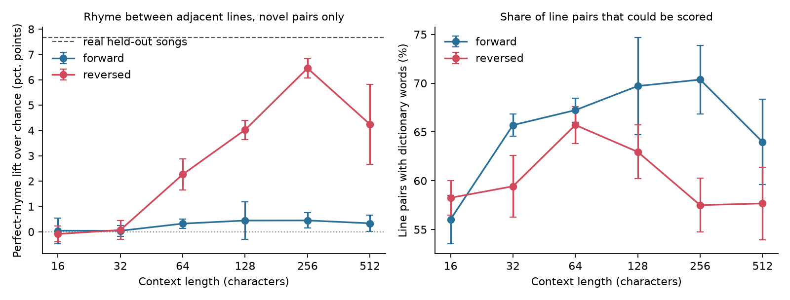

# rap-gpt

**Can a small character-level transformer learn to rhyme?** Giving it more context barely
helped. Generating each line backwards, rhyme word first, took it to about 60% of the rhyme
level of real songs on the fairest measure, using the same model and essentially the same
number of parameters.



The model is the GPT from Andrej Karpathy's [Let's build GPT](https://github.com/karpathy/ng-video-lecture)
lecture, with attention rewritten as one batched module and an optional artist embedding.
This project's own work is the experiment around it: data cleaning, the song-level split,
line reversal, the rhyme metric and its controls, the swap test and the style check.

## Results

Lift is how many percentage points more often adjacent lines perfectly rhyme than the same
end words paired at random. Line pairs copied from training are excluded. Values are the
mean ± standard deviation over 3 seeds.

| Context (chars) | Forward lift | Reversed lift | Reversed, unscored pairs as misses |
|---|---|---|---|
| 16 | +0.0 ± 0.5 | -0.1 ± 0.3 | -0.0 ± 0.2 |
| 32 | +0.0 ± 0.2 | +0.1 ± 0.4 | +0.0 ± 0.2 |
| 64 | +0.3 ± 0.2 | +2.3 ± 0.6 | +1.5 ± 0.4 |
| 128 | +0.4 ± 0.7 | +4.0 ± 0.4 | +2.5 ± 0.3 |
| 256 | +0.4 ± 0.3 | **+6.5 ± 0.4** | **+3.6 ± 0.3** |
| 512 (batch 32) | +0.3 ± 0.3 | +4.2 ± 1.6 | +2.4 ± 0.9 |
| Real held-out songs | +7.7 | | +6.1 |

- **Backwards generation is what produced rhyme.** At context 256, forward stays near chance
  (+0.3 with unscored pairs as misses, against +3.6 reversed).
- **Loss hides this.** Held-out loss at context 256 is 1.401 forward and 1.385 reversed.
- **Rhyme appears once context spans a line or more.** Reversed models show nothing at 16 or
  32 characters and start at 64. The median line is about 41 characters.
- **More context stopped helping, as far as this shows.** Reversed lift was lower at 512, but
  the seeds vary widely (3.2, 6.1, 3.4) and lift two lines apart barely moved. Those runs also
  used batch 32 to fit the GPU and had a warm-up shorter than their context, so this can't
  separate the cause.

### Does the model use the rhyme word?

I replaced the end word of the last context line with a non-rhyming word and sampled the next
line (context 256, 500 contexts, 3 seeds per direction). Percentages count next lines whose
end word is in the dictionary.

| Model | Rhymes with swapped-in word | Rhymes with original word |
|---|---|---|
| Reversed | 0.57% → **4.61%** | 6.26% → 1.63% |
| Forward | 0.84% → 1.05% | 1.33% → 1.29% |

The reversed model's next rhyme follows the swap, and the forward model hardly reacts.

### Artist conditioning

Adding an artist embedding (reversed, context 256, 3 seeds), a character n-gram classifier
identified the requested artist in 75% of generated chunks on average (66%, 75%, 84%). Chance
is 9%, and the same classifier scores 69% on real held-out songs. This doesn't show the model
out-styling real artists: each run has 88 chunks, and the classifier trained on the songs the
models learned from. Rhyme lift was +5.5, against +6.5 without conditioning, a gap about the
size of the spread between seeds.

## Method

- **Data:** 522 songs by 11 artists from the Genius API, about 1.2M characters, only the
  named artist's verses. Cleaning removed release-calendar pages scraped as songs, which were
  about 15% of the raw characters.
- **Split:** 5 whole songs per artist held out, so repeated hooks can't leak into validation
  and every artist is tested.
- **Model:** 6 layers, 6 heads, 384 dimensions, about 10.8M parameters. AdamW at 3e-4, up to
  5000 steps, early stopping on validation loss, bf16 autocast, 80,000 sampled characters per
  run.
- **Reversal:** characters are reversed within each line and line order is kept. Samples are
  flipped back before scoring.
- **Rhyme:** CMU Pronouncing Dictionary, matching sounds from the last stressed vowel onward.
  Repeated words are skipped, since a repeated hook is not a rhyme.

## Limitations

- **Why reversal works is not established.** It does not shorten the distance to the previous
  rhyme, which is about one line either way. A likely reason is that the model can pick the
  rhyme word directly at the start of a line instead of having to arrive at it, but this was
  not tested.
- **Some of the gain is not phonetic learning.** At context 256, 53% of reversed perfect rhymes
  share their last three letters (36% in real songs), and 43% reuse a word pair from training
  (34% in real songs).
- **Coverage differs.** Only 58% of reversed pairs at context 256 could be scored, against 70%
  forward and 80% real, which is why the table also counts unscored pairs as misses.
- **Shared validation songs.** All runs share the same 55 validation songs, so the ± shows
  training variation, not generalisation to other songs.
- **Training isn't equal across contexts.** Shorter contexts see fewer target characters per
  step, and some stopped at or near the 5000-step cap, so they may be under-trained. Block 512
  ran at batch 32.
- **Sampling warm-up is 256 characters.** That fills the context window at every length except
  512, where about the first 13% of each sample was generated with a partly filled window.
- **The swap test samples 70 characters per next line,** which may cut off long forward lines.
  The size of that effect wasn't measured.
- **The metric is crude.** Dictionary pronunciations ignore delivery, and perfect rhyme misses
  much of what rap does with multisyllabic and slant rhyme.
- **Reversal is approximate.** 12.3% of training lines end in `)`, so those don't start with
  the rhyme word when reversed.
- **No listening test.** Nothing here measures whether the output is any good as rap.

## Run it

Lyrics are copyrighted and are not in this repository, and neither are samples or checkpoints.
`scrape_lyrics.py` collects a similar corpus through the Genius API, but not the exact file
used here, so expect similar results rather than identical numbers.

```bash
pip install -r requirements.txt
export GENIUS_ACCESS_TOKEN="..."
python scrape_lyrics.py

python train.py --data data/lyrics_lines.csv --block-size 256 --reversed
pytest
```

The other scripts read `data/lyrics_raw.csv` by default. `run_experiment.sh` runs the grid,
`run_followups.sh` the swap test and artist models, and `analyze.py` rebuilds `results/` from
saved samples. The grid took a few hours on an 8 GB GPU.

## License

MIT. See [LICENSE](LICENSE).
